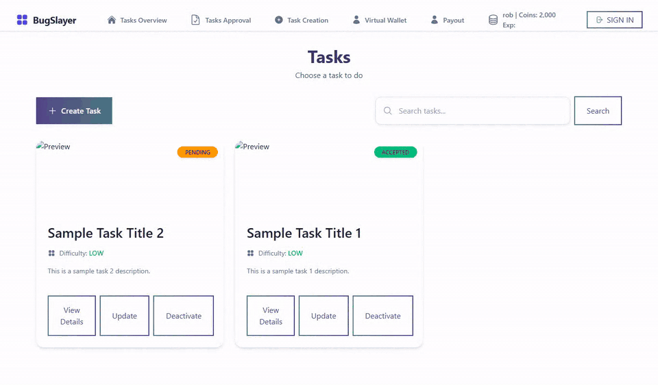
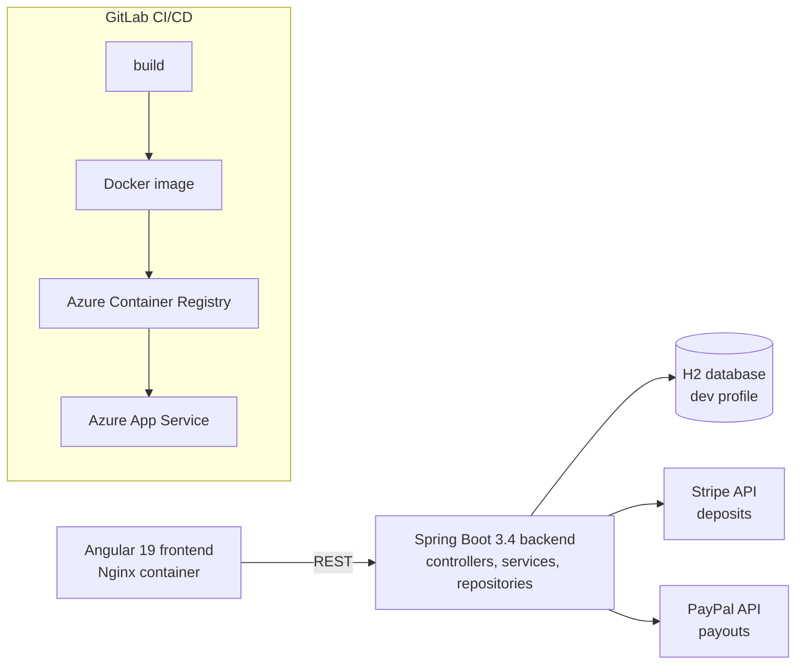
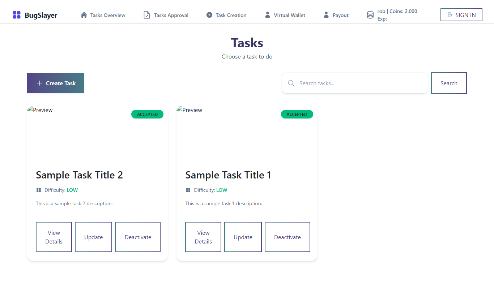
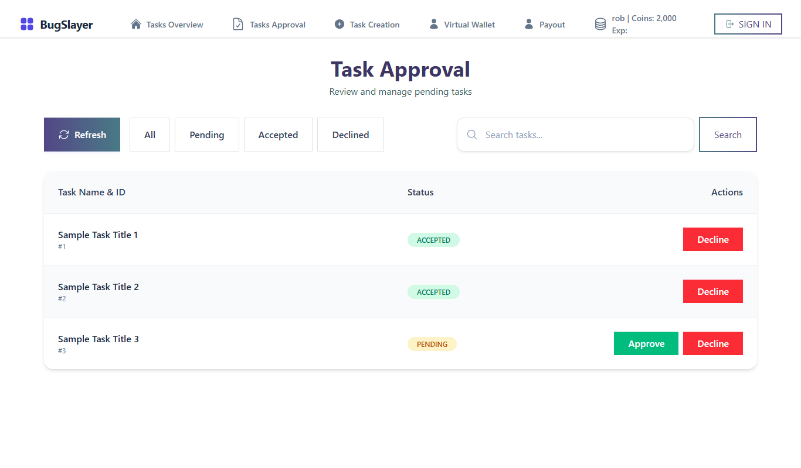
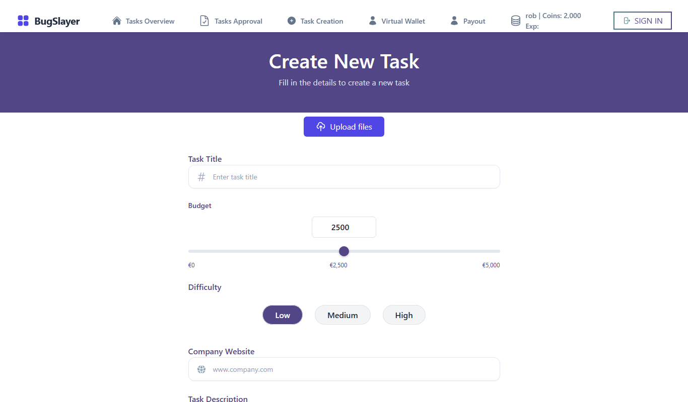
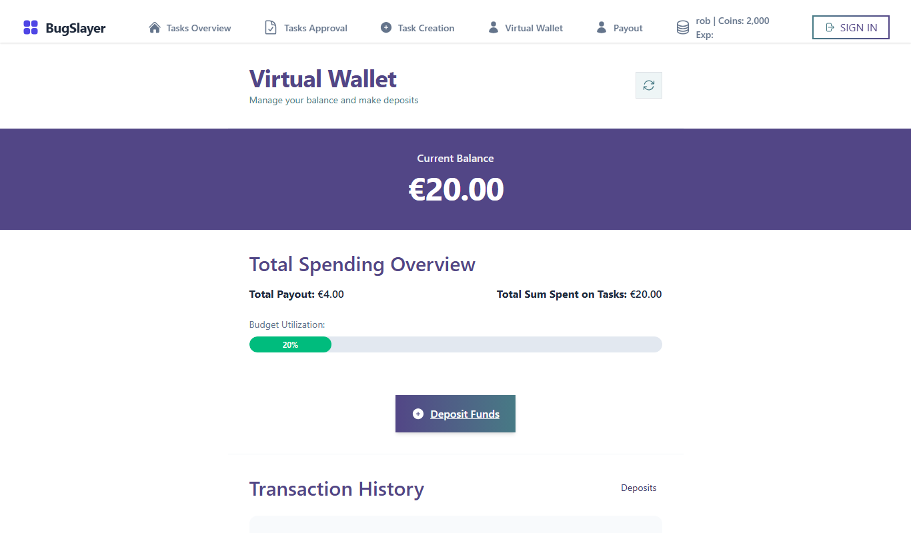

# BugSlayer: crowdtesting and rewards platform (team project)

A web platform where companies post testing tasks with a budget, testers pick a task and report the bugs they find (with a screen recording), admins approve tasks and reports, and testers are meant to be rewarded for approved reports. Built by a team of seven students as our sixth-semester group project (Mar to Jun 2025). Spring Boot backend, Angular frontend, GitLab CI/CD to Azure.



> Recorded on my machine with the backend (in-memory H2 database with seed data) and the frontend running unchanged.

## The problem

The idea: a platform that connects companies who need their websites tested with people who are willing to test them for a reward. Companies should be able to fund tasks, admins should keep quality under control, and testers should be paid out for valid bug reports.

## What it does

- **Tasks:** a company creates a task (title, description, website link, difficulty, budget, payout per accepted report). New tasks start as *pending*.
- **Admin approval:** admins see all tasks and accept or decline them; only accepted tasks are shown to testers. Bug reports go through the same approve/decline flow.
- **Bug reports:** a tester starts a task and submits a report with text, a screen recording and extra files (multipart upload).
- **Wallet and rewards:** users have a virtual balance; companies see their spending and budget use; deposits go through Stripe, payouts through PayPal. A reward service that adds a task's payout to a tester's balance exists, but it is not yet called when a report is approved.
- **Leaderboard and profile:** an all-time leaderboard by experience points and a profile page.

## Architecture



- **Backend:** layered Spring Boot (controllers with DTOs and converters, services behind interfaces, Spring Data JPA repositories, domain classes separate from entities), external payment providers behind `StripeService` / `PaypalService` interfaces, a `DatabaseSeeder` for development data.
- **Frontend:** Angular components per feature (tasks, bug reports, payments, leaderboards, users), Axios services, environment files per stage.
- **Delivery:** both apps have Dockerfiles and GitLab pipelines that build, containerise, push to Azure Container Registry and deploy to Azure App Service, only from the main branch; credentials come from CI variables.

| Tasks | Task approval (admin) |
|---|---|
|  |  |

| Create a task | Virtual wallet |
|---|---|
|  |  |

## Tech stack

Java 17, Spring Boot 3.4 (Web, Data JPA, Security), H2, Stripe Java SDK, PayPal REST API, Gradle, JUnit · Angular 19, TypeScript, Axios, Stripe.js · Docker, Nginx, GitLab CI/CD, Azure Container Registry, Azure App Service.

## How to run it

```bash
# Backend: http://localhost:8080 (dev profile, in-memory H2 with seed data)
cd backend/groupproject_backend
./gradlew bootRun

# Frontend: http://localhost:4200 (calls the backend on localhost:8080)
cd frontend
npm install
npm start
```

Payments need your own Stripe and PayPal sandbox keys (`STRIPE_SECRET_KEY` and the `paypal.*` / `stripeKey` placeholders); everything else works without them.

## My contribution

Team of seven. My parts:
- **Tasks:** task creation (frontend and backend), task update, and the admin approval page (accept/decline) with its backend endpoints.
- **Bug reports:** the backend implementation (multipart upload with screen recording), the approve/decline flow, and the bug report pages in the frontend.
- **Frontend setup:** created the Angular project the team built on.
- **CI/CD:** the GitLab pipelines and Dockerfiles for backend and frontend: build, Docker image, push to Azure Container Registry, deploy to Azure App Service, only from main. I also fixed the CORS setup between the deployed frontend and backend.

In the original repositories I made 89 of the 176 backend commits and 42 of the 142 frontend commits. Many of the backend ones are small pipeline changes: it was my first deployment to Azure, and I set it up step by step while building the features above and keeping up with what the team needed.

My teammates built the other parts, including payments (Stripe and PayPal), the wallet, the leaderboard, the profile and the login.

**About this repository:** the code is our team's and is shown as it was in June 2025. I packaged it for GitHub (this README, screenshots, demo GIF, removing secrets and private details) with help from an AI assistant, which is why the single commit lists Claude as co-author.

## Status and limitations

- Semester group project; it was not released to real users.
- **Security is not finished:** every endpoint is open (`anyRequest().permitAll()`), the login page only navigates to the tasks page (no real authentication), and Keycloak is only partly started in the frontend.
- The backend test sources do not compile against the current code (`PaymentServiceImplTest` calls an older `withdraw` signature), so `./gradlew test` fails; I left them as they are.
- Approving a bug report does not pay the tester yet (the reward service is not wired in), and the leaderboard is empty with the seed data.
- Screen recordings are stored in the database as byte arrays.

## What I would change for production

- Finish authentication and authorization (Keycloak / OAuth2 resource server, roles for company, tester and admin) and lock every endpoint.
- Store recordings and files in object storage and keep only references in the database.
- Repair and extend the tests (unit plus integration for the approval and payout flows) and run them in the pipeline before deploying.
- Make payouts idempotent and auditable (ledger table, webhooks from Stripe/PayPal instead of trusting client calls).
